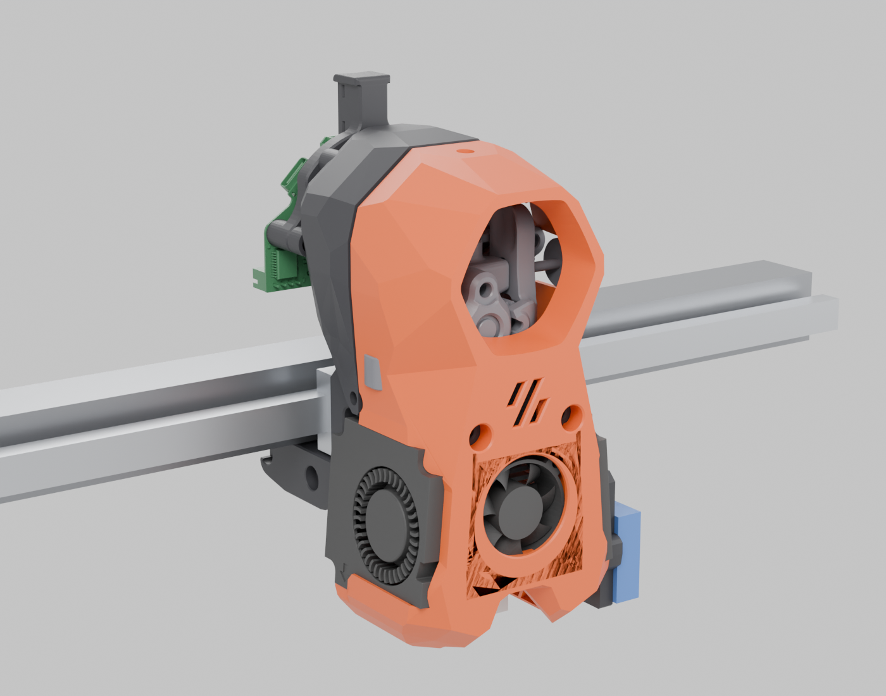

# theenderproject

The ongoing saga of the Ender 3.

## Current build: Mini Stealth v2 toolhead

Build notes, printable parts and Klipper config for fitting atrushing's
[Mini Stealth v2](https://github.com/atrushing/Mini_Stealth) toolhead to an Ender 3.

More views, an interactive 3D viewer and the glTF model are in [`assembly/`](assembly/). Some parts in the render are stand-ins (see that page).

### Configuration

| Item | Choice | Mini Stealth part |
| --- | --- | --- |
| X axis | MGN9H rail, front face of the 2020 extrusion | `Ender3_MGN9H_Front_x-frame_Left/Right` |
| Extruder | Mellow Sherpa Micro (CNC) | Sherpa Micro core, shroud and motor bridge |
| Hotend | Bambu Lab X1 | `MiniStealth_Core_SherpaMicro_Bambu` |
| Hotend fan | Stock X1 2510 fan (5 V) | `…_SherpaMicro_ProbeRight_2510` shroud |
| Part cooling | 2 × 4010 blowers (24 V) with glued air guides | `Blower_guide_x2` |
| Probe | BTT Eddy Coil, right side | `Side_Mount_V0_BTT_Eddy_bracket` (3 heights) |
| Toolhead board | BTT EBB36 Gen2, CAN | `SherpaMicro_Motor_Bridge_UmbilicalPCB_Mount` + `SherpaMicro_UmbilicalPCB_Mount` |
| Mainboard | BTT Manta E3EZ + CB1, USB-to-CAN bridge | [`klipper/printer.cfg`](klipper/printer.cfg) |
| Z axis | kevinakasam belt-driven dual Z, MGN9H rails | `[stepper_z]` + `[stepper_z1]`, `[z_tilt]` |
| Y axis | Stock | |
| Firmware | Klipper | [`klipper/`](klipper/) |

### Repo layout

| Path | What's in it |
| --- | --- |
| [`assembly/`](assembly/) | Renders, interactive 3D viewer (`viewer.html`), glTF model and the scripts that build them |
| [`stl/`](stl/) | Every part to print, copied from the Mini Stealth repo (GPL-3.0, see [`stl/LICENSE`](stl/LICENSE)) |
| [`docs/print-list.md`](docs/print-list.md) | Quantities, materials and which Eddy bracket to choose |
| [`docs/hardware.md`](docs/hardware.md) | Bill of materials: electronics, fans, screws, inserts |
| [`docs/assembly.md`](docs/assembly.md) | Build order and dry-fit checks |
| [`docs/wiring.md`](docs/wiring.md) | EBB36 Gen2 jumpers and wiring |
| [`docs/can-setup.md`](docs/can-setup.md) | CB1 `can0`, Manta bridge firmware and EBB36 firmware |
| [`docs/calibration.md`](docs/calibration.md) | First power-on and calibration order |
| [`klipper/printer.cfg`](klipper/printer.cfg) | Full printer config (Manta E3EZ, dual belted Z, z_tilt, bed mesh) |
| [`klipper/ebb36-gen2-toolhead.cfg`](klipper/ebb36-gen2-toolhead.cfg) | Toolhead: extruder, hotend, fans, Eddy Coil, accelerometer |
| [`klipper/macros.cfg`](klipper/macros.cfg) | PRINT_START / PRINT_END, gantry levelling, first Eddy calibration |

### Status

- [ ] Rail spacing measured (x-frames assume 4.5 mm extrusion-to-rail)
- [ ] Core printed and Mellow Sherpa Micro fit checked
- [ ] Remaining parts printed
- [ ] Toolhead assembled and wired
- [ ] CB1 `can0` up, Manta flashed as USB-to-CAN bridge
- [ ] EBB36 flashed and on CAN, both `canbus_uuid`s filled in
- [ ] Z motors move together, X/Y limits measured
- [ ] Eddy calibrated, z_tilt positions measured, first print done

### Open checks

- **Mellow CNC Sherpa Micro vs the printed core.** The Mini Stealth parts were drawn around the printed Annex Sherpa Micro. Print the core first and confirm the mounting holes line up.
- **Eddy height.** The coil should sit 2–3 mm above the nozzle tip (BTT says about 2.5 mm). Pick the standard, 1 mm-lower or 1.5 mm-lower bracket after a dry fit.
- **X1 thermistor.** "Generic 3950" is community-reported, not published by Bambu. Check it against a thermocouple.
- **Probe offset** X +42, Y −6 comes from the Mini Stealth Ender 3 readme. Verify after the first calibration.

## Credits

- Mini Stealth toolhead and all STLs in `stl/`: [atrushing/Mini_Stealth](https://github.com/atrushing/Mini_Stealth), GPL-3.0. Support thread: [TeamFDM](https://www.teamfdm.com/forums/topic/3433-mini-stealth-v2-is-available/).
- EBB36 Gen2 pin map: [bigtreetech/EBB](https://github.com/bigtreetech/EBB), `sample-bigtreetech-ebb36-gen2-v1.0.cfg`.
- Eddy setup: [BTT Eddy wiki](https://global.bttwiki.com/Eddy.html) and [Klipper Eddy_Probe.md](https://github.com/Klipper3d/klipper/blob/master/docs/Eddy_Probe.md).
- Manta E3EZ pins: Klipper [`generic-bigtreetech-manta-e3ez.cfg`](https://github.com/Klipper3d/klipper/blob/master/config/generic-bigtreetech-manta-e3ez.cfg) and [bigtreetech/Manta-E3EZ](https://github.com/bigtreetech/Manta-E3EZ).
- Belt-driven Z: [kevinakasam/BeltDrivenEnder3](https://github.com/kevinakasam/BeltDrivenEnder3).
