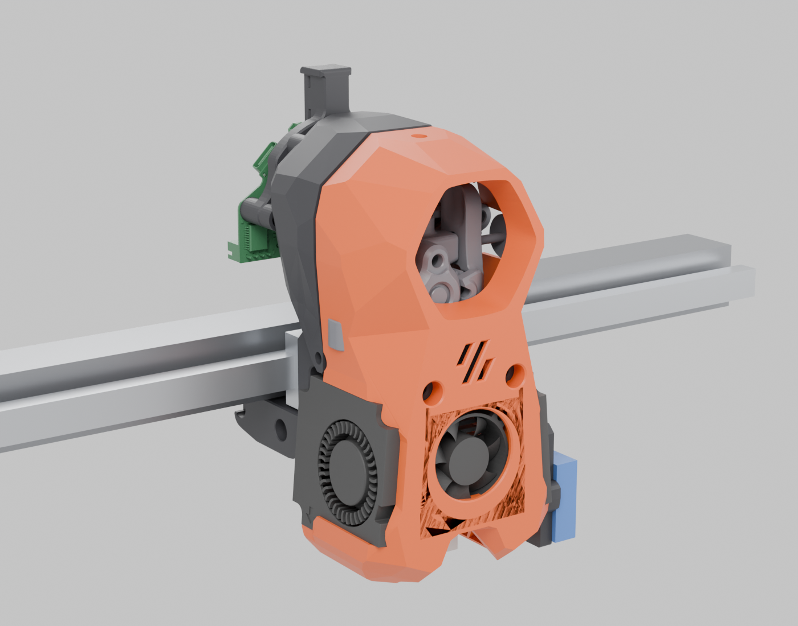
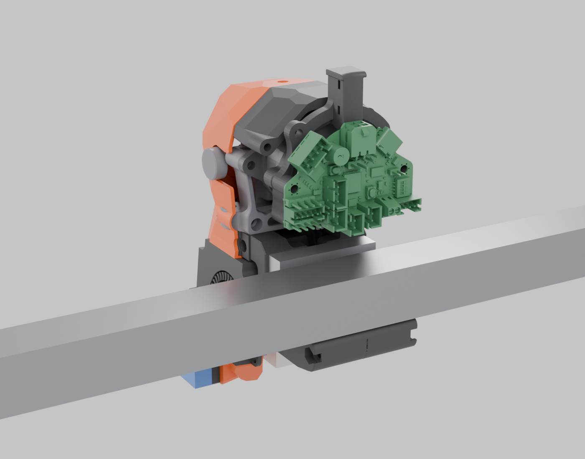
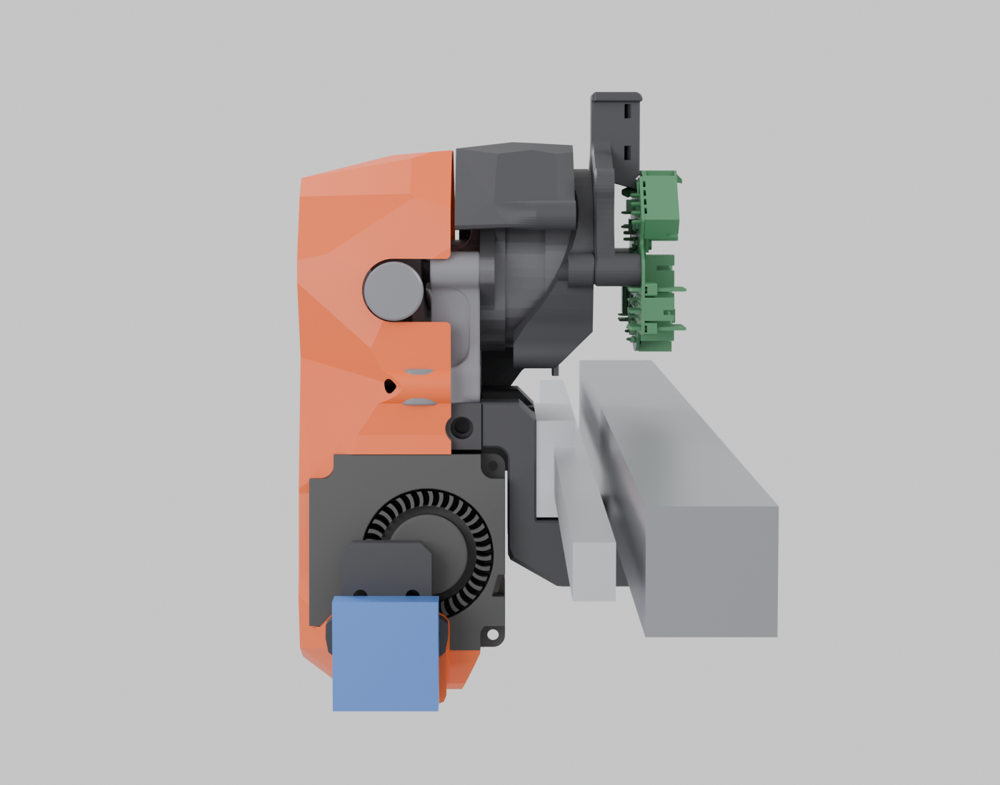
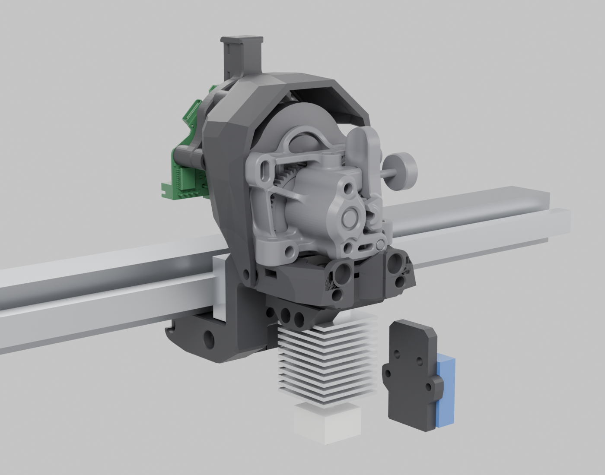

# Toolhead assembly render



| Rear (EBB36 behind the motor) | Right side (Eddy Coil) | Cut-away (shroud and fans hidden) |
| --- | --- | --- |
|  |  |  |

## Files

| File | What it is |
| --- | --- |
| `viewer.html` | Interactive 3D viewer with the model embedded. Download it and open it in a browser; it loads three.js from jsDelivr, so it needs internet access. Rotate the model, toggle parts on and off, or use the cut-away preset |
| `toolhead.glb` | The coloured assembly as glTF. Opens in Blender, Windows 3D Viewer, or online at gltf-viewer.donmccurdy.com |
| `scripts/` | The pipeline that builds the assembly and the renders |

There's also a hosted copy of the viewer on Claude: <https://claude.ai/artifact/BfkWuB76DbCmoEdZt3mXcG>. It's private to its owner until it's shared from that page.

## How the parts are placed

The Mini Stealth STLs are exported at scattered positions and in print orientation, not assembled. They're positioned as follows:

| Part | Method |
| --- | --- |
| Shroud, core, cable door | Matched (ICP) against the designer's Sherpa Mini Blender assembly, `Extruders/Sherpa_Mini/Mini_Stealth_Sherpa_Mini.blend`. Mean error is under 1 mm |
| X-frame halves | Placed from the core's 25 mm screw holes onto the frame's heat-set inserts. The frame tops land within 0.3 mm of the designer's Switchwire x-frame |
| Eddy bracket | Its M2.5 holes line up with the ProbeRight shroud's mounting holes |
| Motor bridge, PCB mount | Share a 43.8 mm hole pair on the motor's centre line. The mount ends up in almost exactly the same position as the designer's mount in the .blend |
| Motor, EBB36, fans | Taken straight from the designer's .blend. The EBB36 is the v1 model, which has the same footprint as the Gen2. The 2510 fan is a scaled 3010 model |

**Stand-ins and proxies:**
- The extruder is the Sherpa **Mini** model from the .blend, standing in for the Mellow Sherpa Micro CNC.
- The Bambu X1 hotend, Eddy Coil, MGN9H rail and block, and the 2020 extrusion are simple blocks.

Positions are approximate. Use this to see how the build goes together, not to check fit.

## Rebuilding

You need Python 3 with `trimesh`, `numpy`, `scipy` and `rtree`, plus Blender's `bpy` module (the PyPI `bpy` wheel needs Python 3.11). You also need a local clone of [atrushing/Mini_Stealth](https://github.com/atrushing/Mini_Stealth).

```
cd assembly/scripts
export WORK=$PWD/work
# 1. pull the reference meshes out of the designer's .blend
python3.11 export_ref.py /path/to/Mini_Stealth/Extruders/Sherpa_Mini/Mini_Stealth_Sherpa_Mini.blend
# 2. place our STLs + proxies, write PLYs and a manifest
python3 build_scene.py
# 3. render (Cycles, CPU) – view = [azimuth, elevation, distance factor]
SAMPLES=64 python3.11 render_bl.py --views '{"front":[-35,15,3.0],"rear":[150,20,3.0]}'
#    hide parts for a cut-away
SAMPLES=64 python3.11 render_bl.py --hide shroud,hotendfan,blowers --views '{"cutaway":[-40,12,2.8]}'
# 4. coloured glTF for the viewer
python3.11 export_glb.py --views '{}'
```

`place.py` holds every part's transform. Edit it if a part needs nudging, then rerun steps 2–4. `viewer_template.html` is the viewer before the model is embedded. To rebuild `viewer.html`, put `toolhead.glb` next to it and change `.parse(...)` back to `.load('toolhead.glb', ...)`, or embed the new GLB as base64 the same way.
